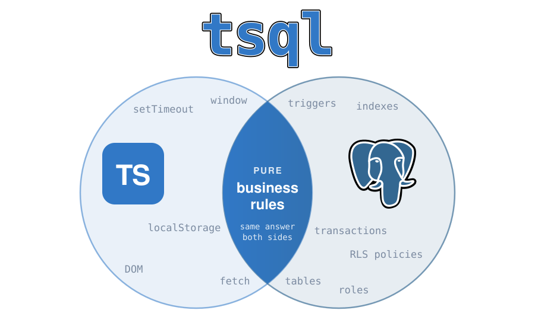

<div align="center">



### Write each pure function once, in TypeScript — tsql compiles it to PostgreSQL and proves both give the same answer.

[](https://github.com/alexandre-dos-reis/tsql/actions/workflows/ci.yml)
[](https://www.npmjs.com/package/@adr/tsql)
[](LICENSE)

</div>

## Why

The same check often lives twice: in TypeScript, so the UI can grey out a button, and in SQL, because
only the database can enforce it.

<table>
<tr><th>You write</th><th>tsql generates</th></tr>
<tr><td>

```ts
export function canCreateTodo(
  plan: string,
  count: Integer,
): boolean {
  return plan !== "free" || count < 3;
}
```

</td><td>

```sql
CREATE OR REPLACE FUNCTION app.can_create_todo(
  plan text,
  count integer
)
RETURNS boolean
LANGUAGE plpgsql
IMMUTABLE
AS $$
BEGIN
  RETURN plan <> 'free' OR count < 3;
END;
$$;
```

</td></tr>
</table>

Kept in step by hand, the two drift apart the day someone changes one of them. tsql removes the second
copy, then **proves** the two agree by running both on hundreds of random inputs. Anything it cannot
translate *exactly* is a build error, never a guess.

## Quick start

**1. Install** — Node 22.18+ or Bun, with TypeScript 7 as a peer:

```bash
npm i -D @adr/tsql typescript@~7.0.2     # or: bun add -d @adr/tsql typescript@~7.0.2
```

**2. Give your functions their own project**, `functions/tsconfig.json`. `"types": []` keeps Node and
browser globals out: a function cannot reach for something the database does not have.

```json
{
  "compilerOptions": {
    "strict": true,
    "noEmit": true,
    "lib": ["ESNext"],
    "module": "preserve",
    "moduleResolution": "bundler",
    "types": []
  },
  "include": ["."]
}
```

**3. Write a function**, `functions/billing.ts`:

```ts
import type { Integer } from "@adr/tsql/pgtypes";

export type Plan = "free" | "pro" | "enterprise";

export function todoLimit(plan: Plan): Integer {
  if (plan === "free") {
    return 3;
  } else if (plan === "pro") {
    return 100;
  }
  return 1000;
}
```

`Integer` is a plain alias of `number`: it tells tsql you meant `integer`, not `double precision`.

**4. Compile, then prove:**

```bash
npx tsql compile functions/*.ts    # writes generated/0001_functions.sql
npx tsql parity functions/*.ts     # checks every function against its TypeScript
```

```sql
-- functions/billing.ts: Plan, a union of strings
DO $$ … CREATE DOMAIN app.plan AS text
  CONSTRAINT plan_values CHECK (VALUE = ANY (ARRAY['enterprise', 'free', 'pro'])); … $$;

-- functions/billing.ts: todoLimit()
CREATE OR REPLACE FUNCTION app.todo_limit(
  plan app.plan
)
RETURNS integer
LANGUAGE plpgsql
IMMUTABLE
AS $$
BEGIN
  IF plan = 'free' THEN
    RETURN 3;
  ELSIF plan = 'pro' THEN
    RETURN 100;
  END IF;
  RETURN 1000;
END;
$$;
```

Point your migration tool at the generated file. Running it again is safe: it creates what is missing,
brings a changed union or enum in line, and fails loudly rather than drop or rewrite anything.

## Commands

| Command | Does | Writes |
| --- | --- | --- |
| `tsql compile <files…>` | type check, translate, write the migration and a manifest | yes |
| `tsql check <files…>` | type check and translate — put it in CI next to your type checker | nothing |
| `tsql parity <files…>` | prove each function agrees with its TypeScript | nothing |

| Option | For | Default |
| --- | --- | --- |
| `--project <tsconfig>` | all | `functions/tsconfig.json` |
| `--schema <name>` | all | `app` |
| `--no-comments` | all | comments on |
| `--out <file>` | `compile` | `generated/0001_functions.sql` |
| `--manifest <file>` | `compile` | `generated/manifest.json` |
| `-w, --watch` | `check` | off; keeps running and checks again on every save |
| `--runs <n>` | `parity` | `200` |
| `--seed <n>` | `parity` | random; replays a failure |
| `--db-url <url>` | `parity` | an in-process PGlite |

Files are always named (a glob is fine); there is no "compile everything" default. `tsql <command>
--help` lists a command's options. Every command exits non-zero on a refused construct, and `parity`
also on a divergence.

## Parity

`tsql parity` loads the migration into [PGlite](https://pglite.dev) — real PostgreSQL 18, in process,
no server — and runs each function on 200 random inputs ([fast-check](https://fast-check.dev)), through
your TypeScript and through the generated SQL. A difference fails with the smallest input that shows it:

```
todoLimit("free") diverges: TypeScript gave 3, PostgreSQL gave 4
  functions/billing.ts vs select app.todo_limit($1::text) as value
  reproduce with seed -315639818, path 0
```

`--db-url=postgres://…` runs the same checks on your own PostgreSQL, inside a transaction that is always
rolled back. Use a test database: the run briefly locks functions with the same names.

> It proves the **translation**, not your logic. If `todoLimit("free")` should be 3 and both sides say
> 30, parity passes. Keep your own unit tests on the TypeScript.

## TypeScript → PostgreSQL

| TypeScript | PostgreSQL |
| --- | --- |
| `string`, `boolean` | `text`, `boolean` |
| `number` | `double precision` |
| `Integer`, `Numeric`, `Float` (from `@adr/tsql/pgtypes`) | `integer`, `numeric`, `double precision` |
| `T \| null` | a nullable value, compared with `IS [NOT] DISTINCT FROM` |
| `type Plan = "free" \| "pro"` | a domain: `text` with a `CHECK` on its values |
| a string `enum`, or an `as const` object of strings | an enum, in the order written |
| a named `interface` or object `type` | a composite type; a field of a named object type is a column of its composite |
| `readonly T[]` | `t[]` |
| `a / b` | always `double precision`, as in TypeScript |
| `` `${a}-${b}` ``, `??`, `c ? a : b` | `\|\|`, `COALESCE`, `CASE` |

## What's supported

Exported `function` declarations and `const` arrow functions with written parameter and return types,
calling each other; `const` and `let`; `if`, `switch` (with a `default`), `while`, `for`, `for … of`,
`break`, `continue`; arithmetic, comparisons, boolean operators; object literals, spread and
destructuring; `xs.length` and `xs.includes(x)`.

## What's not

Each of these is refused with a message saying what to write instead. Most are refused because the
SQL would *quietly* give a different answer:

- **Anything outside the function**: `Math`, `Date`, `JSON`, `fetch`, imported packages, `async`.
- **Truthiness** (`if (name)`), loose equality (`==`), `&&`/`||` on non-booleans.
- **`<` on strings** — the database orders by collation, TypeScript by UTF-16.
- **Mutation**: of a parameter, an object field or an array — PL/pgSQL passes by value.
- **Array methods with a callback** (`map`, `filter`, `some`…) — write the loop; `xs[i]`.
- **Optional parameters and `undefined`** — write `T | null`.
- **Anonymous object types**, even nested (`customer: { tier: string }`) — give the shape a name; and a nested object that may be `null`.
- **Generics, numeric enums, `var`, `do … while`, `for … in`.**
- **Returning rows** (`SETOF`/`TABLE`) and database access: query in SQL, decide in the function.

The full list, with the reason for each, is in [docs/design.md](docs/design.md#rejected-at-build-time).

## Using the functions from SQL

A compiled function is an ordinary `IMMUTABLE` PostgreSQL function. Three patterns cover most uses —
all three run in CI from [`examples/usage.sql`](examples/usage.sql).

**A condition on one row: a `CHECK` constraint.**

```sql
CREATE TABLE products (
  sku text PRIMARY KEY CHECK (app.is_not_empty(sku)),
  ...
);
```

**A value derived from the row: a generated column.**

```sql
price_cents double precision GENERATED ALWAYS AS (app.price_cents(list_cents, percent_off)) STORED
```

**A condition involving other rows: a trigger.** The trigger gathers the data and takes the locks; the
function decides.

```sql
CREATE FUNCTION enforce_todo_limit() RETURNS trigger LANGUAGE plpgsql AS $$
DECLARE
  sub app.subscription;
  current_count integer;
BEGIN
  SELECT plan INTO sub FROM users WHERE id = NEW.user_id FOR UPDATE;
  SELECT count(*)::integer INTO current_count FROM todos WHERE user_id = NEW.user_id;
  IF NOT app.can_create_todo(sub, current_count) THEN
    RAISE EXCEPTION 'todo limit reached' USING ERRCODE = 'check_violation';
  END IF;
  RETURN NEW;
END;
$$;

CREATE TRIGGER todos_enforce_limit BEFORE INSERT ON todos
  FOR EACH ROW EXECUTE FUNCTION enforce_todo_limit();
```

**Calling conventions:**

| The function takes or returns… | From SQL |
| --- | --- |
| an object | `ROW(a, b)::app.thing`, one value per field in declaration order; a nested object is a `ROW` of its own |
| an object, returned | `(app.f(…)).field`, or `SELECT (app.f(…)).*` |
| an `Integer` | an `integer`: cast `count(*)`, which is a `bigint` |
| a named union or an enum | a column of that type, so the database refuses unknown values |
| an array | `ARRAY(SELECT …)`, not `array_agg`, which is NULL over no rows |
| a `T` that is not `T \| null` | a non-NULL value: the function does not check |

**When a function changes**, PostgreSQL does not recompute what was stored with the old one: re-check
existing rows against a `CHECK` (`SELECT … WHERE NOT app.f(…)`), rewrite rows to refresh a generated
column, and `REINDEX` an expression index. A trigger has none of these problems.

## Status

Pre-1.0: a minor version may change defaults or the generated SQL, and says so in the
[changelog](CHANGELOG.md). TypeScript is pinned to `~7.0.2` because tsql reads its `unstable/` compiler
API, which may move between 7.x minors. Tested on PostgreSQL 18, in CI and through PGlite.

## Learn more

- [docs/design.md](docs/design.md) — why each mapping and each refusal is what it is: null handling,
  objects, named types, arrays, the parity harness.
- [CONTRIBUTING.md](CONTRIBUTING.md) — toolchain, tests, CI, releases.
- [examples/](examples/) — a few functions and the SQL they compile to.

## Licence and trademarks

`tsql` is MIT licensed — see [LICENSE](LICENSE).

PostgreSQL and the PostgreSQL elephant logo ("Slonik") are trademarks or registered trademarks of the
PostgreSQL Community Association of Canada, used here to identify the database this project targets.
The elephant artwork in `assets/logo.svg` is the PostgreSQL project's own, distributed under the
[PostgreSQL Licence](https://www.postgresql.org/about/licence/). The wordmark is drawn from
[Geist Mono](https://github.com/vercel/geist-font) (SIL Open Font License 1.1).

TypeScript is a trademark of Microsoft Corporation. The `TS` tile in the logo is original artwork, not
Microsoft's mark.

This project is not affiliated with, sponsored by, or endorsed by the PostgreSQL Community Association
of Canada or Microsoft Corporation.
